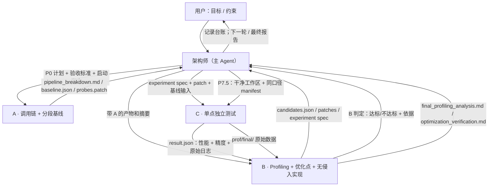

# 多 Agent 协作模式（默认）

本技能**默认启用多 Agent 协作**。适用于全流程、长链路、多轮实验的调优任务；任务较小时也优先按角色启动，由架构师合并任务以降低开销。

仅以下情况降级为单 Agent，并在 `agent/plan.md` 记录原因：
- 用户明确要求单 Agent；
- 运行环境不支持子代理/`Agent` 工具；
- 任务只是单点验证（如只跑一次基线），且用户同意简化。

本模式中：**主 Agent 担任“总体架构师”**，负责派活、验收、状态管理和最终报告；A/B/C 是三个子 Agent（subagent）。不要让架构师本身再作为子 Agent 去嵌套调度，否则上下文会二次丢失。

## 目录

1. 角色总览
2. 协作主流程（含与 P0–P8 的映射）
3. 交接规范（artifact-first）：固定目录、Context Pack 模板、state.json
4. 角色卡：架构师、小弟 A、小弟 B、小弟 C
5. 分卡并行测试与集成验证
6. 质量控制（防止自证与移动球门）
7. 失败与异常处理
8. 降级模式（默认不启用）
9. 子 Agent Prompt 模板

## 1. 角色总览

| 角色 | 定位 | 主要职责 | 不做什么 | 关键产出 |
|---|---|---|---|---|
| **架构师**（主 Agent） | 项目经理 + 验收人 | 定目标/指标/口径/验收标准；维护 `state.json` 和台账；给 A/B/C 派活；检查每个交付物；升级需要用户拍板的决策；汇总最终报告和 patch | 不深入算子分析、不亲自写优化代码 | `final_report.md`、`optimization_ledger.md`、`invasive_candidates.md`、`patches/`、`agent/state.json` |
| **小弟 A** | 调用链与基线分析师 | P1 静态调用链拆解；P2 设计打点、生成 `probes.patch`、跑分段基线；P2 末采集 `prof/baseline/` 并写 manifest；输出 `pipeline_breakdown.md` 与 `baseline.json` | 不提优化建议、不改模型逻辑（打点除外） | `pipeline_breakdown.md`、`baseline.json`、`prof/baseline/`、`artifacts/probes.patch`、`agent/handoff_A.md` |
| **小弟 B** | Profiling 分析与优化工程师 | P3/P4 分析 profiling 和基础无侵入手段；P5 形成优化点候选；**实施无侵入 patch（环境变量/融合算子）**；写实验 spec（含验收阈值）；P7.5 分析 final profile 并填生效矩阵 | 不自己宣布测试通过（以 C 的数据为准）；不实现侵入性方案（只列清单并按预期收益排序） | `profiling_analysis.md`、`optimization_candidates.json`、`patches/NNN-*.patch`、`final_profiling_analysis.md`、`optimization_verification.md`、`agent/handoff_B.md` |
| **小弟 C** | 独立测试工程师 | 按 B 的 experiment spec 做单点测试：同轮 control vs candidate、同卡同输入、warmup/重复次数、性能 + 精度；P7.5 在干净卡/干净工作区按 manifest 采集 `prof/final/`（含最终环境变量）；保存原始日志和结果 | 不修改优化代码、不调整验收阈值、不替 B 下“是否采纳”的结论 | `artifacts/tests/<opt_id>/result.json`、`run.log`、`precision/`、`prof/final/`、`agent/handoff_C.md`（结果文件同时供 B 判定和架构师验收） |

> **关键**：如果 B 只做分析不做实现，必须增加“小弟 D · 优化实施工程师”，否则流程会断在“谁改代码”。本技能默认 B 兼任实施。

## 2. 协作主流程



### 与 P0–P8 的映射

| 阶段 | 主责 | 说明 |
|---|---|---|
| P0 接入/环境/口径 | 架构师（C 可代跑环境检查） | 架构师定目标、口径、验收标准、创建分支 |
| P1 调用链拆解 | A | 输出 Mermaid + 打点位置表 |
| P2 分段打点基线 | A | 生成 probes.patch，跑 baseline；C 可提前准备测试输入和参考输出 |
| P3 Warm-start | B（C 测试） | B 选环境变量组/入口 import，C 按单点测试 |
| P4 Profiling | B | B 自己采集并分析（需要边跑边调 profiler 配置） |
| P5 优化迭代 | B（C 测试） | B 提出并实现无侵入候选（环境变量/融合算子）；C 独立测；B 判定；架构师记录；侵入性候选列清单交用户 |
| P6 安全实施 | B | 每步 py_compile/import 校验；保留开关 |
| P7 复测/精度 | C（B 判定） | C 做最终 paired 复测；B 对照预先阈值判定 |
| P7.5 最终 profiling 复核 | C 采集 + B 分析（架构师验收） | C 在干净工作区、加载最终环境变量后按 `prof/baseline/manifest.json` 同口径采集 `prof/final/`；B 写 `final_profiling_analysis.md` / `optimization_verification.md`；架构师按硬门禁验收 |
| P8 报告/Patch | 架构师 | 架构师汇总；git 仓库运行 `make_patches.py`，非 git 仓库收集逐点 diff，写报告 |

## 3. 交接规范（artifact-first）

### 3.1 固定目录

所有协作产物放在 `perf_reports/<YYYYMMDD>/agent/`：

```text
agent/
├── plan.md                  # 架构师的总体计划：目标、指标、验收标准、任务队列
├── state.json               # 架构师维护的唯一状态源
├── experience_recall.json   # P0 召回的匹配经验
├── experience_harvest.md    # P8 本次新增/更新的经验摘要
├── handoff_A.md             # A 的交接摘要
├── handoff_B.md             # B 的交接摘要
├── handoff_C.md             # C 的交接摘要
├── tasks/
│   ├── 001-A-callchain.md   # 给 A 的完整任务包
│   ├── 002-B-profiling.md
│   └── 003-C-test-O1.md
└── ...
```

### 3.2 架构师派活时的 Context Pack 模板

每次给子 Agent 的任务描述都必须包含以下内容，缺一不可：

```markdown
# 任务：<角色> · <阶段> · <任务名>

## 项目目标
- 模式：<推理 / 训练>
- 目标指标：<推理：E2E ms / DiT 单步 ms；训练：s/step / P50 / P99 / 吞吐>
- 精度红线：<阈值>
- 可改动范围：<只允许无侵入（环境变量/融合算子）/ 其他约束 ...>

## 当前状态
- 仓库：<路径>
- 分支：<npu-tuning/YYYYMMDD>
- 当前 commit：<hash>
- 上一轮基线：<baseline.json 路径 + 关键数字>
- 已应用优化：<列表或 none>

## 前序结论（只传需要同步的部分）
- <3–8 条要点，必须带证据文件路径>
- 例：A 的分段基线显示 dit_denoise 占 72.9%（见 baseline.json）

## 输入文件
- <绝对路径列表>

## 你的任务
1. ...
2. ...

## 输出要求（必须写文件）
- <文件路径与 JSON/Markdown schema>

## 完成标准
- <可检查的 checklist>

## 边界
- 不要做：...
```

**原则**：架构师不要把上一个 Agent 的完整 transcript 贴给下一个 Agent；只传“关键事实 + 文件路径 + 待解决问题”。文件是唯一可信来源。

### 3.3 state.json 建议结构

```json
{
  "goal": {"mode": "inference", "metric": "e2e_ms", "target": "<= 800", "precision": "cosine>=0.999"},
  "protocol": {
    "baseline_runs": 3,
    "jitter_threshold_pct": 10,
    "inference": {"screen": {"warmup": "1 round", "denoise_steps": 5}, "baseline": {"warmup": "1 round", "denoise_steps": "~10", "dit_step_warmup": 5}, "final": {"denoise_steps": "same as baseline"}},
    "training": {"screen": {"warmup": 20, "steps": 10}, "baseline": {"runs": 3, "log_metrics": "s/step, P50, P99, throughput", "full_run": true}, "final": {"warmup": 20, "steps": "original script"}}
  },
  "model_info": "artifacts/model_info.json",
  "repo": "/path/to/model",
  "repo_type": "git",
  "backup": "非 git 仓库填 backup_src/ 路径",
  "branch": "npu-tuning/20260101",
  "baseline_commit": "abc1234",
  "phase": "P5a",
  "current_baseline": {"metric": "e2e_ms", "median": 1234.5, "jitter_pct": 0.9, "file": "baseline.json", "commit": "abc1234"},
  "profiles": {
    "baseline": {"dir": "prof/baseline", "manifest": "prof/baseline/manifest.json", "purpose": "P2 pre-P3 baseline"},
    "warmstart": {"dir": "prof/warmstart", "manifest": "prof/warmstart/manifest.json", "optional": true},
    "final": {"dir": "prof/final", "manifest": "prof/final/manifest.json", "purpose": "P7.5 P7 integration branch + final env", "same_config_as_baseline": true}
  },
  "tasks": [
    {"id": "001", "owner": "A", "status": "done", "output": "pipeline_breakdown.md"},
    {"id": "002", "owner": "B", "status": "in_progress"},
    {"id": "003", "owner": "C", "status": "pending", "depends_on": "002"}
  ],
  "optimizations": [
    {"id": "O1", "name": "attention backend", "status": "accepted", "perf": "-12.3%", "precision": "cosine 0.9998", "profiling_status": "verified"}
  ],
  "invasive_candidates": {"file": "invasive_candidates.md", "count": 5, "pending_user_decision": 5}
}
```

架构师独占写权限；子 Agent 只读并写自己的 handoff 文件。

## 4. 角色卡（可直接作为 subagent prompt 的骨架）

### 4.1 架构师（主 Agent）

**职责**
- 与用户确认目标、指标、精度红线、可改动范围。
- P0：执行 `scripts/experience.py search` 召回经验，写入 `agent/experience_recall.json`；记录 `artifacts/model_info.json`；环境检查、分支创建（非 git 仓库做完整备份）、smoke 验证。
- 制定 `plan.md`，定义每个任务的验收标准（在测试前写死）。
- 按依赖顺序派活；A 先出基线，B 才能分析；B 出实验 spec，C 才能测试。
- P8：执行 `scripts/experience.py add/update`，把本次的新经验写入对应类别，并回写复用经验的结果。
- 每次收到交付物先验收：文件存在、数字成对、口径一致、无打点代码进入最终 patch。
- **P7.5 硬门禁**：核对 `prof/baseline/` 与 `prof/final/` 的 manifest 同口径（配置、rank、warmup、active/denoise steps）；验收 `final_profiling_analysis.md` 和 `optimization_verification.md`，`failed` 项不得进入最终 patch，`time_only` 必须有 P7 同卡成对性能证据。
- 维护 `state.json` 和 `optimization_ledger.md`；失败实验也要记。
- 侵入性候选（按预期收益降序）、冲突、精度回归 → 汇总成 `invasive_candidates.md` 决策清单交用户。
- P8 生成 patch 并写 `final_report.md`：git 仓库运行 `make_patches.py`；非 git 仓库收集 P6 的逐点 `diff -uN` patch 并生成 `all.patch`。

**明确不做**
- 不替 A 画调用链、不替 B 分析 kernel、不替 C 跑测试。
- 但必须**读懂并验收**他们的关键结论，不能只做转发。

### 4.2 小弟 A · 调用链与基线分析师

**输入**：仓库、启动脚本、目标口径、精度约束、允许修改打点的范围。

**任务**
1. 先读 `references/pipeline-analysis.md`、`references/instrumentation.md`，再读 `agent/experience_recall.json` 中的 `code-reading` 经验，带着这些假设追调用链，并在 handoff 里记录哪些经验有用/不适用。然后从启动脚本追到真实执行路径：先定位 pipeline 类/函数及其 `__call__`/`forward`/`train_step`，再找 pipeline 对每个模型组件（text_encoder / DiT / VAE / 条件编码器）的调用点，最后进入模型定义记录类/forward/关键算子位置。产出 `pipeline_breakdown.md`：调用链表 + **模型定义与调用映射表** + Mermaid 图（标注 T1/T2… 打点位置）。
2. 设计打点方案：扩散模型至少覆盖 `prompt_encode` / `image_encode` / `dit_denoise` 总时间 / `dit_step` 单步（5 步预热后）/ `vae_decode`；训练覆盖单步内的 `dataloader` / `forward` / `backward` / `optimizer` / `zero_grad`（若含 text_encoder / VAE / DiT，再按实际模型组件细分）。
3. 生成 `artifacts/probes.patch`（打点代码只在 patch 里，默认关闭）。
4. 跑基线与分段计时，产出 `baseline.json`：推理独立跑 **3 次任务**（E2E 抖动 ≤ 10%），固定 10 步左右，含 3 轮原始值、E2E 中位数/抖动、各阶段时间/占比、**DiT 单步时间（5 步预热后）/抖动**；训练独立跑 **3 次任务**（日志 `s/step` 抖动 ≤ 10%），**不报 E2E**，P50/P99/吞吐从完整训练任务日志取，另附单步内各阶段时间/占比。用 `scripts/baseline_stats.py` 校验并记录抖动结论。
5. **P2 基线 profile**：在 P3 O2 环境变量组之前，按 P7.5 同口径采集 `prof/baseline/`（`NPU_TUNE_PROBE=0`，Level1 + PipeUtilization，主 rank，同 warmup/active 步数与输入），写 `manifest.json`。这份 profile 只用于最终对照，不作为性能数字。
6. 写 `agent/handoff_A.md`：关键发现、最重阶段、计时不确定性、模型定义与调用映射的关键条目、baseline/final profile 对照口径和文件路径。

**不做**：不提优化建议；除打点外不改模型逻辑。

### 4.3 小弟 B · Profiling 分析与优化工程师

**输入**：A 的 `pipeline_breakdown.md`、`baseline.json`、`probes.patch`；当前分支代码；可用融合算子清单。

**任务**
1. 先读 `agent/experience_recall.json` 中的 `optimization-methods` 和 `device-issues` 条目，把匹配项作为候选假设，不要直接照搬。
2. P4 采集并分析 profiling：按 `references/profiling-recipes.md` 采集（**默认只采主 rank，全 rank 需用户确认**；扩散 profiling 可用 5 步），按 `references/profiling-analysis.md` 做 step_trace 分型、算子透视、Roofline 与慢卡判断，写 `profiling_analysis.md`。
3. P3 评估基础无侵入手段：按 `references/warmstart-defaults.md` 检查 `torch_npu` 接入与候选环境变量，作为一个优化点成组提出。
4. P5 形成候选清单 `optimization_candidates.json`，分两组（推理场景优先查 `references/inference-optimization-playbook.md` 的路线图与"症状 → 候选"表；训练场景查 `references/training-optimization-playbook.md`）：
   - `non_invasive`：**只允许环境变量组与融合算子替换**。融合算子必须先跑 `python scripts/scan_fusion_ops.py --detail --json <repo>/perf_reports/<date>/artifacts/fusion_ops.json`，只列本机实际存在的接口，并从 A 的 `pipeline_breakdown.md` 模型定义映射定位到具体 `file:line`，参考签名/说明确认参数，按 `fusion-op-catalog.md` 的收益/精度规则筛选；
   - `invasive_pending_decision`：其余全部改动，**按预期性能收益从高到低排序**（依据优先级：P4 热点占比 × 预计消除比例 > 经验库实测 > 理论估算）。

   每项包含（来自经验的要写 `experience_id`）：
   ```json
   {
     "id": "O2",
     "category": "non_invasive",
     "priority_rank": 1,
     "name": "rmsnorm fusion",
     "evidence": {"task_type": "AICPU 42%", "top_op": "rms_norm 18%", "file": "prof/..."},
     "why": "RMSNorm 未融合，AICPU 回退",
     "change": "replace with npu_rms_norm, keep original as fallback",
     "intrusion": "none | low | medium | high",
     "expected_gain": "3-5%",
     "expected_gain_basis": "rms_norm 18% × 预计消除 60%，待实测",
     "change_scope": ["src/model.py:120"],
     "effort": "0.5 day",
     "risk": "精度/兼容性/回退风险",
     "depends_on": [],
     "rollback": "开关关闭 + 恢复原实现",
     "experiment_spec": {
       "patch": "patches/002-rmsnorm-fusion.patch",
       "command": "bash run.sh ...",
       "protocol": {
         "screen": "P2/P7 筛选口径（推理 warmup 1 轮 / 5-step；训练 warmup 20 / 10-step）",
         "baseline": "推理 3 次任务、denoise ~10 步、E2E 抖动≤10%、DiT 单步 5 步预热；训练 3 次完整任务、日志 s/step 抖动≤10%、P50/P99/吞吐取日志",
         "final": "与基线同一步数的完整 pipeline / 原始启动脚本；训练完整任务"
       },
       "repeats": 3,
       "jitter_threshold_pct": 10,
       "precision_threshold": {"cosine": 0.999}
     }
   }
   ```

   `invasive` 组使用同一结构，`intrusion` 填 `medium` / `high`，按 `priority_rank` 从高到低排序；预期收益必须写清是 P4 证据估算、经验库实测还是理论估算（标"待验证"）。
5. 对 `non_invasive` 候选：实现 patch，保留开关和原实现，`py_compile` 通过后交 C。非 git 仓库按 `SKILL.md` P6 执行：每点动手前把待改文件备份到 `artifacts/backups/<opt_id>/` 并登记 `sha256`，改完立即生成该点 `diff -uN` patch 与 `changes.log`，确保可单点回退。
6. 对 `invasive_pending_decision`：只写清单，不实现、不排期，由架构师按优先级汇总成决策清单交用户。
7. 收到 C 的结果后，**按事先写死的阈值**判定：`accepted` / `rejected` / `inconclusive`，并写清依据；不达标就回滚或提出下一个变体。
8. **P7.5 最终 profiling 分析**：收到 C 采集的 `prof/final/` 后，与 `prof/baseline/` 按相同口径分析（`scripts/profile_compare.py` 或 `profile_summary.py`），写 `final_profiling_analysis.md`，并填 `optimization_verification.md` 的每个已采纳优化点：预期签名、baseline 证据、final 证据、逐点收益、状态。`failed` 项反馈架构师回查/回滚，`time_only` 需引用 C 的 P7 `result.json` 成对数据。

**不做**：不宣布自己实现的东西“通过”，必须等 C 的数据；不修改 C 的测试脚本或阈值；不自己采集 `prof/final/`（避免在开发工作区自证）。

### 4.4 小弟 C · 独立测试工程师

**输入**：B 的 `experiment_spec`（patch、命令、`protocol`、重复次数、精度阈值）、基线参考输出、`baseline.json`。

**任务**
0. **卡空闲门禁**：先运行 `scripts/check_cards.py --devices <分配卡号> --json artifacts/tests/<opt_id>/cards_before.json`；退出码非 0 就停下并报告架构师，不要 `kill` 别人的进程，也不要自行换卡。
1. 测试前确认：同一张卡（记录 NPU id）、同一输入/seed、同一 batch/分辨率、同一环境变量、同一 commit；记录 `ASCEND_RT_VISIBLE_DEVICES` 映射。
2. 每个候选测试都做**同轮 paired 对照**：
   - control：当前已固化基线（不含本候选）
   - candidate：应用本候选 patch
   - 顺序可交替（AB/BA）以避免热漂移。
3. 性能：按 `references/instrumentation.md` 口径——推理独立跑 3 次任务，固定 10 步左右（筛选可 5-step），报 E2E 中位数/抖动（要求 ≤ 10%）、各阶段时间/占比、**DiT 单步时间（5 步预热后）/抖动**；推理不报 P50/P99/吞吐。训练独立跑 3 次任务，`s/step` 抖动 ≤ 10%，**不报 E2E**；P50/P99/吞吐从完整训练任务日志取，另用打点给出单步内各阶段时间/占比。定稿复测必须用完整 pipeline / 原始启动脚本且与基线同口径。可用 `scripts/baseline_stats.py` 校验 3 轮抖动并留档。
4. 精度：保存候选输出，用 `compare_outputs.py` 与参考输出对比；主判据统一 `cosine ≥ 0.999`；训练也用固定 batch 前向输出的 cosine 作主判据，loss/grad norm 作为辅助监控。
5. 产出 `result.json`：
   ```json
   {
     "opt_id": "O2",
     "mode": "inference",
     "patch": "patches/002-rmsnorm-fusion.patch",
     "commit": "def5678",
     "device": {"chip": "Ascend910", "npu_id": 0, "ascend_rt_visible_devices": "0"},
     "cards_before": "artifacts/tests/O2/cards_before.json",
     "cards_after": "artifacts/tests/O2/cards_after.json",
     "protocol": {"runs": 3, "denoise_steps": 10, "jitter_threshold_pct": 10, "dit_step_warmup": 5},
     "control": {
       "runs": [{"run": 1, "e2e_ms": 1230.0}, {"run": 2, "e2e_ms": 1238.0}, {"run": 3, "e2e_ms": 1229.0}],
       "e2e_ms_median": 1230.0, "e2e_ms_jitter_pct": 0.7,
       "dit_step_ms_median": 90.0, "dit_step_jitter_pct": 1.2,
       "stages": [{"name": "dit_denoise", "ms_median": 900.0, "share_pct": 72.9},
                  {"name": "dit_step", "ms_median": 90.0, "note": "dit_denoise 子项，不参与占比求和"}]
     },
     "candidate": {
       "runs": [{"run": 1, "e2e_ms": 1180.0}, {"run": 2, "e2e_ms": 1185.0}, {"run": 3, "e2e_ms": 1179.0}],
       "e2e_ms_median": 1180.0, "e2e_ms_jitter_pct": 0.5,
       "dit_step_ms_median": 86.2, "dit_step_jitter_pct": 1.0,
       "stages": [{"name": "dit_denoise", "ms_median": 860.0, "share_pct": 72.0},
                  {"name": "dit_step", "ms_median": 86.2, "note": "dit_denoise 子项，不参与占比求和"}]
     },
     "delta_pct": -4.1,
     "precision": {"cosine": 0.99992, "max_abs_diff": 0.003, "mean_abs_diff": 0.0002},
     "thresholds": {"cosine": 0.999, "jitter_pct": 10},
     "pass": true,
     "notes": "3 轮抖动均 ≤ 1%，同卡同输入"
   }
   ```
   训练场景：去掉 `e2e_ms_*`，改为 3 轮日志 `s_per_step`（含 `jitter_pct`）、`p50_s_per_step`、`p99_s_per_step`、`samples_per_s`（均来自完整训练日志），`stages` 使用单步内 `dataloader / forward / backward / optimizer / zero_grad` 的中位数与占比；精度主判据仍为固定 batch 前向输出的 `cosine ≥ 0.999`，loss/grad norm 辅助记录。训练没有 E2E 时间指标。
6. **P7.5 最终 profile 采集**：在 P7 的干净集成分支/工作区（`baseline_commit` + 全部已采纳 patch，内容与最终 `all.patch` 等价）、加载最终环境变量（`artifacts/env.applied.sh`）、空闲卡上，按 `prof/baseline/manifest.json` 的 profiler 配置、rank、warmup、active/denoise steps、输入规格采集 `prof/final/`；`NPU_TUNE_PROBE=0`。该 run 只用于机制证据，不作为最终性能数字。写 `prof/final/manifest.json`，并在 handoff 中给出 baseline/final 同口径核对结果。
7. 写 `agent/handoff_C.md`：测了什么、原始日志路径、异常、是否达标、final profile 路径与同口径核对。

**不做**：不改优化代码、不调整阈值、不替 B 判断“是否采纳”；patch 应用失败只报告，不自行修；P7.5 不在带未提交改动的开发工作区采集。

## 5. 分卡并行测试与集成验证

### 5.1 测试前的卡空闲门禁（必须）

每次 C 开始测试前，先对分配到的卡执行：

```bash
python scripts/check_cards.py --devices 0,1,2,3 --json artifacts/tests/<opt_id>/cards_before.json
```

- 退出码必须为 0；输出中每张卡 `process_count == 0` 且 `utilization_pct` 低。
- **不能只看 HBM**：Ascend 空闲状态下 HBM 也可能有数 GB 预留；主要依据 `npu-smi info` 的进程表和 AICore 利用率。
- 如果发现别的进程：不要 `kill`，记录 PID/进程名和 HBM 占用，报告架构师等待或换卡。
- 测试结束后再采一次 `cards_after.json`，确认没有残留进程。

架构师在 `state.json` 里维护卡分配：

```json
{
  "cards": {
    "total": [0, 1, 2, 3, 4, 5, 6, 7],
    "leases": [
      {"devices": [0], "owner": "C-O1", "task": "test attention backend", "status": "running"},
      {"devices": [1], "owner": "C-O2", "task": "test rmsnorm fusion", "status": "pending"}
    ]
  }
}
```

每个 C 测试任务必须写明 `ASCEND_RT_VISIBLE_DEVICES=<分配的物理 chip logic id>`，并在 `result.json` 记录实际使用的卡号。C 不得自行换卡。

### 5.2 什么时候可以分卡并行

**可以并行**（需同时满足）：
- 每个测试有**互不重叠**的卡集合；
- 架构师可以起多个 C 子代理（`C-1`、`C-2`…），**一个 C 只跑一个测试、只负责一个卡集合**；不要让同一个 C 同时跑多个测试；
- 默认只在**单卡推理/单卡 benchmark**场景并行；多卡训练测试默认串行；
- 主机 CPU、内存、磁盘、PCIe 带宽足够，不会互相抢资源；
- 供电和温度有余量，`npu_monitor.py` 未出现降频/高温；
- 同一测试的 control 与 candidate 使用**同一张/同一组卡**，顺序执行（AB 或 BA 交替），不能把 control 放 A 卡、candidate 放 B 卡。

**不要并行**：
- 多卡 HCCL 训练测试共享网络/交换，除非集群支持硬隔离且已验证无干扰；
- 最终权威性能数字（必须串行、独占卡）；
- 基线测量与任何 profiling/测试同时跑；
- 两个测试共用一个 `ASCEND_OPP_CACHE`（算子编译缓存会互相锁/污染）；每个测试用独立缓存目录。

**卡间差异**：并行前可用同一小 benchmark 在各卡上各跑一次做 calibration；如果卡间差异 > 2–3%，跨卡绝对数字不可直接比较，但同卡 paired delta 仍有效。最终数字回到指定的一张安静卡/一组卡上串行复测。

### 5.3 并行测试的定位：只做筛选

并行测试是**候选筛选（screening）**：每个候选都从同一个基线 commit 出发、在各自卡上独立测试，得到的是“单点增益”。

它不能替代**堆叠验证**：候选之间的相互作用（收益叠加、抵消、精度累积）只有按顺序叠加后才能看出来。

所以流程是：

```text
并行筛选（多候选、各自独立卡） → 选出值得集成的候选
        ↓
串行集成（按顺序叠加） → 每加一个点，复测一次（control=上一个栈，candidate=栈+本点）
        ↓
最终全栈复测 → 报告里的权威数字
```

### 5.4 集成验证（必须做）

一批并行候选测试完成后，架构师执行：

1. **确定集成顺序**：按依赖关系/预期收益/风险排序；把候选 patch 依次应用到从 `baseline_commit` 新建的集成分支或 worktree。可用 `scripts/verify_stack.py --repo <repo> --base <commit> --patches <patch_dir>` 自动在临时 worktree 验证；非 git 仓库则在 `backup_src/` 的临时副本上按顺序 `patch -p1` 验证，结果写入 `stack_verify.json`。
2. **检查 patch 可应用性**：git 仓库每个 patch 先 `git apply --check`；非 git 仓库在临时副本上 `patch -p1 --dry-run`。有冲突退回 B，让 B 基于当前栈重做 patch，C 不修改 patch。
3. **逐点集成复测**：
   - control = 当前已集成栈（第一次为原始基线）
   - candidate = 当前栈 + 本优化点
   - 同卡、同输入、同 warmup/重复次数、打点关闭
   - 记录**单点增量**（相对当前栈）和**累计值**
4. **交互检查**：如果叠加后收益明显小于各单点收益之和，属于正常（优化可能重叠）；但如果叠加后性能低于基线或低于最佳单点，需回退/二分定位冲突点。
5. **最终全栈验证**：
   - 从 `baseline_commit` 新建集成分支/worktree 并按顺序应用全部已采纳 patch（内容须与最终 `all.patch` 等价）
   - 完整 smoke + full benchmark + 精度校验（打点关闭）
   - 再跑一遍打点开启的阶段耗时，用于报告中的阶段对比
   - 确认集成分支与最终交付 patch 不含任何 `StageTimer` / `NPU_TUNE_PROBE` / 打点代码
6. **P7.5 最终 profile 复核**：在**同一个干净集成工作区**、加载最终环境变量、空闲卡上，由 C 按 `prof/baseline/manifest.json` 同口径采集 `prof/final/`（probe 关闭）；B 用 `scripts/profile_compare.py` 对比并写 `final_profiling_analysis.md` / `optimization_verification.md`；架构师验收。`failed` 项必须回查/回滚并重新采 `prof/final/`，不能带病进入 P8。
7. **更新台账**：`optimization_ledger.md` 至少记录两列——`standalone_gain`（并行筛选值）和 `stacked_gain`（集成后增量）；最终报告以 `stacked_gain` 为准。另加 `profiling_status`（`verified` / `mechanism_verified` / `time_only` / `failed`）。

## 6. 质量控制（防止自证与移动球门）

1. **验收标准前置**：B 在把候选交给 C 之前，把 `precision_threshold`、性能判定口径写进 `experiment_spec`；C 按此测试，B 不得在看到结果后改阈值。
2. **原始数据留存**：C 保留 `run.log`、profiler 产物、输出张量/图片；`result.json` 中的每个数字都能追溯。
3. **架构师验收**：检查 `result.json` 是否有 control 和 candidate、是否同轮同卡、精度是否真的跑了、patch 是否真的来自 B、最终 `all.patch` 是否不含 probes。
4. **失败也记录**：`rejected` / `inconclusive` 的候选写入 `optimization_ledger.md`，避免下一个 Agent 重复踩坑。
5. **数字不一致时**：以 C 的原始日志为准，B 的解释只能作为辅助证据；架构师有权要求重测。
6. **最终 profile 独立采集**：`prof/final/` 必须由 C 在 P7 干净集成分支/工作区（`baseline_commit` + 全部已采纳 patch，内容与最终 `all.patch` 等价）+ 最终环境变量的干净工作区、空闲卡上采集，不能在 B 的开发工作区采；baseline/final 的 manifest 必须同口径，否则结论无效。

## 7. 失败与异常处理

| 情况 | 处理 |
|---|---|
| A 跑不通模型 | A 报告 blocker 给架构师；架构师决定最小修正或找用户，不把问题甩给 B |
| B 的 patch 无法应用 | C 报告给 B 和架构师；B 重做 patch，C 不自行改 |
| C 测试波动大（> 5%） | 增加重复次数、AB/BA 交替；仍大则判 `inconclusive`，不算通过 |
| 精度超阈值 | B 回滚或提出改进变体；架构师记录，不写入最终 patch |
| P7.5 优化点 `failed` | B 回查 patch 命中/环境变量/fallback；确认无效则回滚，C 重新采 `prof/final/`，不得带病出报告 |
| baseline/final profile 口径不一致 | 作废，重采；检查 manifest 的配置、rank、warmup、active steps、输入规格 |
| 侵入性候选 | B 只列清单并按预期收益降序；架构师汇总给用户决策 |
| Agent 结论冲突 | 架构师以文件和原始数据为准，必要时让 C 复测 |

## 8. 降级模式（默认不启用）

默认使用完整三角色 A/B/C。只有在满足降级条件时才使用以下模式，并必须在 `agent/plan.md` 写明原因：

- **两角色**：A+B 合并为“分析实施”，C 保持独立测试；适合中等任务，仍保留独立验证。
- **单 Agent**：仅限用户明确要求、环境不支持子代理，或单点验证且用户同意；直接按 SKILL.md 走。
- **角色合并原则**：可以合并“分析+实施”，但**不要合并“实施+独立测试”**——否则会失去独立验证，容易自证。

## 9. 子 Agent Prompt 模板

```text
你是 npu-model-tuning 技能的「小弟 <A/B/C>：<角色名>」。
你只负责 <职责范围>，不做 <边界外的事>。

项目目标：...
当前状态：branch=<...>, commit=<...>, baseline=<...>
前序结论：<3-8 条，带文件路径>
输入文件：<绝对路径>
你的任务：<编号步骤>
输出要求：<文件路径 + schema>
完成标准：<checklist>
边界：<不要做的事>

完成后请把结果写入 <handoff 文件>，并在最终回复里给出 5 行以内的摘要 + 文件路径。
```
