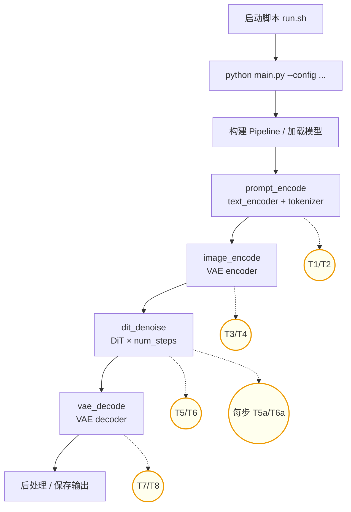

# P1 · 静态分析：调用链拆解与打点位置

目标：从**启动脚本**追到真正执行计算的位置，产出一张可打点的调用链 + **模型定义与调用映射表**，并画出带打点位置的 Mermaid 流程图。这张图和映射表是后续所有打点、profiling 归因、融合算子替换和报告的统一依据。

## 怎么追踪：四层调用链

必须按下面的顺序追，不能只看启动脚本里的阶段名：

1. **启动脚本层**：读启动脚本（`.sh` / `run.py` / `benchmark.py` / `torchrun` 命令行），记录：
   - 设置了哪些环境变量（尤其是 `ASCEND_RT_VISIBLE_DEVICES`、`TASK_QUEUE_ENABLE`、`PYTORCH_NPU_ALLOC_CONF`）
   - 真正调用的 Python 入口文件/模块与参数
2. **Pipeline 层**：找到编排整个推理/训练流程的类或函数。
   - 推理：`DiffusionPipeline` / `WanPipeline` / 自研 `pipeline.py` 的 `__call__` / `forward` / `generate`；
   - 训练：训练循环里的 `train_step` / 单个 step 函数 / `forward`；
   - 记录 pipeline 的定义 `file:line` 和启动脚本里的调用点。自研框架没有标准 Pipeline 类时，找 `main()` 里真正顺序执行模型调用的编排函数，不要按目录名猜。
3. **模型调用层**：在 pipeline 内按执行顺序找每个模型组件的调用点：
   - `text_encoder`（tokenizer / T5 / CLIP 等）
   - `image_encoder` 或 VAE encoder（参考图/源视频，如有）
   - `DiT` / `transformer`（去噪循环）
   - `vae_decode` / VAE decoder
   - 其他条件编码器（音频、视觉、VLM 等）
   - 每个组件记录：构造/加载点（`from_pretrained` / `AutoModel` / `build_model` / `load_checkpoint`）→ pipeline 调用点 `file:line`。
4. **模型实现层**：进入每个模型类/函数的定义，记录：
   - 模型类/函数名与定义 `file:line`、forward 入口 `file:line`；
   - 关键子模块和算子位置：Attention（QKV / softmax / out proj）、Norm（RMSNorm / LayerNorm / Add+Norm）、RoPE、FFN / 激活（SwiGLU / GELU）、VAE 卷积 / 逐元素；
   - 这些位置就是 P5 融合算子替换和 P5b 侵入性候选的落点，必须能精确回指。
5. **切分阶段**：把执行路径切成有序的、可观测的阶段，判定推理还是训练。
   - 推理：拆出整条流水线每一部分及它使用的模型/模块
   - 训练：拆出一个 step 的各部分
6. **记录打点位置**：每个阶段"开始前 / 结束后"各一个时间点，标到 `file:line`。
7. **判定先验热点**：哪段最重（大模型 forward、循环 `num_steps`、逐样本 Python 循环、numpy 聚类等），给 P4 profiling 一个预期。

> 外部包/已安装框架：记录包名、版本与 `external:<package>`；能读源码时继续记录 `file:line`，不能读时明确标注，不要编造位置。

> 以 diffusers 为例：`run.sh` → `demo.py` 构造 `pipe = DiffusionPipeline.from_pretrained(...)` → `pipe(...)` 进入 `DiffusionPipeline.__call__` → `pipe.text_encoder(...)` / `pipe.transformer(...)` / `pipe.vae.decode(...)`；再进入各自模型类 forward 定位算子。

## 输出：`pipeline_breakdown.md`

### 1. 调用链表

| # | 阶段名 | 使用的模型/模块 | 源码 file:line | 输入 → 输出 | 打点位置 | 先验热点 |
|---|--------|----------------|----------------|-------------|----------|----------|
| 1 | prompt_encode | text_encoder + tokenizer | `pipeline.py:120` | prompt → embeds | T1: `pipeline.py:118`, T2: `pipeline.py:125` | 低 |
| 2 | image_encode | VAE encoder | `pipeline.py:130` | 参考图 → latent | T3/T4 | 中 |
| 3 | dit_denoise | DiT transformer | `pipeline.py:180` | latent → latent | T5/T6（含循环内单步 T5a/T6a） | 高 |
| 4 | vae_decode | VAE decoder | `pipeline.py:240` | latent → 输出 | T7/T8 | 中 |

### 2. 模型定义与调用映射表（必须）

| 组件 | 模型类/函数 | 定义 file:line | 构造/加载点 | pipeline 调用点 | forward 入口 | 关键算子/融合候选 | 备注 |
|---|---|---|---|---|---|---|---|
| text_encoder | `T5EncoderModel` | `...` | `pipeline.py:120` | `pipeline.py:210` | `...` | LayerNorm / FFN | external transformers 4.x |
| DiT / transformer | `WanTransformer3DModel` | `models/transformer.py:88` | `pipeline.py:135` | `pipeline.py:260` | `models/transformer.py:400` | Attention / RMSNorm / RoPE / FFN | |
| VAE decoder | `AutoencoderKL` | `...` | `pipeline.py:150` | `pipeline.py:310` | `...` | conv / elementwise | |

> 这张表是 P4 profiling 热点回查源码、P5 融合算子替换定位 `file:line` 的桥梁；没有它，融合算子候选和侵入性清单只能停在"某阶段"，无法执行和评估精度影响范围。

### 3. Mermaid 流程图（必须标注打点位置）

在报告中用 Mermaid 画调用链，并用 `probe` class 标注打点位置：

> 如果调用链有分支（如 CFG、不同输入路径、条件分支），把分支画出来；计时点放在"每次都会经过的边界"上。循环体（`num_steps`、逐样本 for）要单独标出，因为它常是隐蔽热点。
>
> 模型定义层级较深时，拆成两张图：pipeline 调用图（本图）+ 模型 forward 展开图（模型类 → forward → 关键子模块/算子）；报告中两者都保留，后者用于融合算子替换定位。

## 扩散模型拆解模板（重点）

以视频/图像编辑模型为例，pipeline 一般由三部分组成：

| 阶段 | 包含内容 | 说明 |
|---|---|---|
| `prompt_encode` | tokenizer + text_encoder | prompt / 文本编码，通常每次请求执行一次 |
| `image_encode` | VAE encoder（参考图/源视频编码） | 图像编辑、图生视频、视频编辑场景有；纯文生图可能没有 |
| `dit_denoise` | DiT transformer × `num_inference_steps` | 去噪循环，通常是最重阶段；需记录总耗时和单步平均 |
| `vae_decode` | VAE decoder | latent → 最终图像/视频帧 |

如果模型有额外的音频编码器、视觉编码器（如 VLM 条件编码）、文本/图像交叉注意力预处理，也作为独立阶段列出，不要混进 `prompt_encode`。

## 训练模型拆解模板

| # | 阶段 | 说明 |
|---|---|---|
| 1 | dataloader / batch fetch | 含数据加载、预处理、H2D 拷贝（常是空泡来源） |
| 2 | forward | 前向 + loss 计算 |
| 3 | backward | 反向 |
| 4 | optimizer.step() | 更新权重（含梯度累积 / DDP/HCCL 通信） |
| 5 | zero_grad() | 清零 |

多卡/多进程：标注哪些阶段含通信（DDP all-reduce、HCCL）；把 `torchrun` 启动方式、rank 数、并行策略写进 P0 记录。

## 注意事项

- 模型定义必须落到类/函数和 `file:line`；只记录 pipeline 阶段或脚本参数不够，P5 的融合算子替换需要这些位置。
- 拆解要到"可观测的边界"：不必拆到单个算子（那是 profiling 的事），但要能回答"时间花在哪一段、这段用哪个模型"。
- 自研框架（如 cosmos-framework）没有标准 pipeline 类时，从启动脚本的 `main()` 和配置构建处开始追，找到实际执行循环；不要按框架名字猜。
- 静态分析看不清的地方，用 `torch_npu.profiler` 的 `with_stack=True` 抓一次调用栈来校正。
- 记录 batch / seq / dtype / 并行配置，报告和复现都要用。
