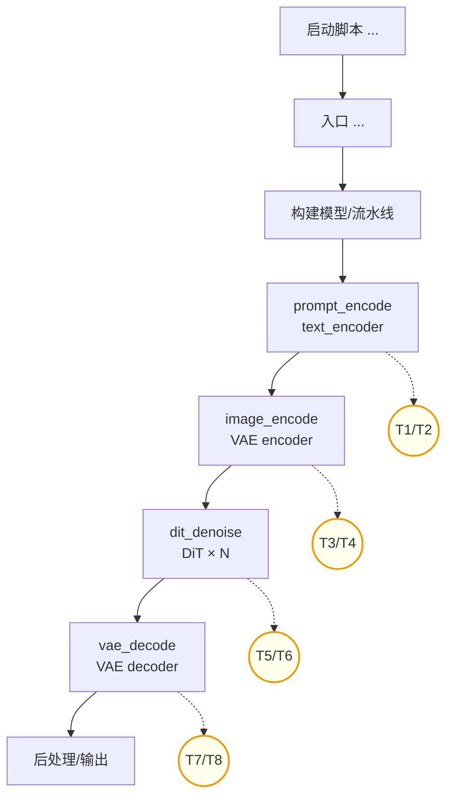

# P8 · 最终报告固定模板（`final_report.md`）

**严格按下面的 8 节顺序撰写，不要增删顺序。** 报告用中文，简洁；所有数字必须成对出现（基线 vs 优化后），并写清口径（warmup / 测量次数 / 是否多卡 / 计时边界）。

```markdown
# <模型名> Ascend NPU 性能调优报告

## 1. 环境信息

> 数据来源：`artifacts/env_info.json`（P0 `env_check.py --repo <repo> --json` 保存）。

- 硬件：芯片型号 <Ascend 910 / 910B>，卡数 <8>，单卡 HBM <64 GB>
- 软件：OS <...>、驱动 <...>、CANN <...>、Python <...>、torch <...>、torch_npu <...>
- 框架/依赖：<diffusers / transformers / 自研框架版本>
- 代码状态：git 仓库填 `<url/name>`、调优分支 `<branch>`、基线 commit `<hash>`；非 git 仓库填源路径、完整备份 `backup_src/` 与 `artifacts/changes.log` 位置
- 关键环境变量：
  | 变量 | 值 | 说明 |
  |---|---|---|
  | `ASCEND_RT_VISIBLE_DEVICES` | ... | ... |
  | `TASK_QUEUE_ENABLE` | ... | ... |
  | `PYTORCH_NPU_ALLOC_CONF` | ... | ... |
- 设备可见性/逻辑映射：<物理卡 → 逻辑卡>

## 2. 模型信息

> 数据来源：`artifacts/model_info.json`（P0 记录；缺失项注明 `unknown`/待确认）。

- 模型名称：<...>
- 模型类型：<DiT 生成模型 / cosmos 类 world model / ...>
- 框架/实现：<diffusers / cosmos-framework / 自研>
- 结构类型：<DiT + VAE + text_encoder / cosmos 类 world model / ...>
- 参数量：<...>
- 精度：<BF16 / FP16 / FP32>
- 输入规格：分辨率 <...>、帧数 <...>、序列长度 <...>、batch <...>
- 并行策略 / 部署方式：<单卡 / DDP / FSDP / 多进程 / ...>
- 代码版本：<git branch + commit hash / 非 git backup_id；有无本地改动>

## 3. 调优前基线

- 原始启动命令：
  ```bash
  <原启动脚本或命令>
  ```
- 计时口径：
  - 包含：<模型加载 / 输入预处理 / forward / 后处理 ...>
  - 不包含：<首次编译 / 数据下载 / ...>
- 测量方式：**独立跑 3 次任务**（推理 denoise steps=<N>，固定 10 步左右；训练完整任务）；推理 E2E / 训练日志 `s/step` 抖动 `(max-min)/median` 必须 ≤ 10%，否则基线无效重采
- 基线指标（推理，只有时间指标，不报 P50/P99/吞吐）：
  | 指标 | 数值 |
  |---|---|
  | E2E 时延（3 轮中位数 / 抖动%） | ... |
  | DiT 单步时间（5 步预热后中位数 / 抖动%） | ... |
  | 显存峰值（allocated / reserved，资源观测，不参与性能判定） | ... |
- 基线指标（训练，无 E2E）：
  | 指标 | 数值 |
  |---|---|
  | s/step（3 轮中位数 / 抖动%） | ... |
  | P50 s/step（完整训练日志） | ... |
  | P99 s/step（完整训练日志） | ... |
  | 吞吐 samples/s（完整训练日志） | ... |
  | 显存峰值（allocated / reserved，资源观测） | ... |
- 基线阶段耗时：见第 4 节（与本节基线同一次测量；`baseline.json` 同时保存逐轮值、E2E/s·step 与各阶段）
- 原始多次测量值：3 轮逐轮数值与抖动；原始数据见 artifacts/

## 4. 阶段打点耗时

- 打点方式：`stage_timer`，每个计时点前后 `synchronize()`（`torch.cuda.synchronize()` 经 `transfer_to_npu` 等效，或 `torch.npu.synchronize()`）
- 各阶段耗时（推理，打点开启，warmup=<K>，denoise steps=<N>）：

| 阶段 | 时间中位数 (ms) | 占比 (%) | 说明 |
|---|---|---|---|
| prompt_encode | ... | ... | text_encoder |
| image_encode | ... | ... | VAE encoder（如有） |
| dit_denoise | ... | ... | DiT 去噪循环总时间 |
| dit_step | ... | —（dit_denoise 子项） | **单步时间，前 5 步预热后采集** |
| vae_decode | ... | ... | VAE decoder |
| **E2E** | ... | 100 | 3 轮中位数，抖动 ...% |

> 训练场景：阶段行替换为**单步内**的 `dataloader` / `forward` / `backward` / `optimizer` / `zero_grad`，多卡时标注 HCCL 所在阶段；训练没有 E2E 行，P50/P99/吞吐以完整训练日志为权威口径。推理不报 P50/P99。

- 结论：最重阶段为 <...>，占比 <...>；初步瓶颈判断 <计算 / 搬运 / 通信 / 数据加载>。

## 5. 调用链分析

- 启动脚本：`<run.sh>` → `<python entry.py ...>`
- 调用链层级：启动脚本 → pipeline 类/函数（`__call__` / `forward` / `train_step`）→ 各模型组件调用 → 模型定义/forward → 关键算子实现
- 调用链（带源码位置与打点位置）：



> 训练场景：把 D–G 替换为 `dataloader → forward → backward → optimizer → zero_grad`，并在图中标注对应打点位置（多卡标注 HCCL）。

- 模型定义与调用映射（P1 产出，至少覆盖 text_encoder / DiT / VAE / 条件编码器）：
  | 组件 | 模型类/函数 | 定义 file:line | 构造/加载点 | pipeline 调用点 | forward 入口 | 关键算子/融合候选 |
  |---|---|---|---|---|---|---|
  | text_encoder | ... | ... | ... | ... | ... | ... |
  | DiT / transformer | ... | ... | ... | ... | ... | ... |
  | VAE decoder | ... | ... | ... | ... | ... | ... |

- 关键代码位置：
  | 阶段 | 文件:行号 | 说明 |
  |---|---|---|
  | ... | ... | ... |

## 6. 优化点逐一说明

> 每个优化点一小节。性能收益是**单点增量**（基于上一个固化状态）；精度影响必须写实测方法与结果。

### 优化点 1：<名称>

- **现象**：<profile / 分段 / npu-smi 观察到的具体证据，如 AICPU 占 60%、某阶段占 72%>
- **为什么做这个优化**：<原因、机理、预期>
- **改动**：patch 文件 `patches/001-<name>.patch`；涉及 <file:line>；开关 `<ENV_VAR>`；回退方式 <...>
- **性能收益**：推理报 E2E 基线 <X> → 本优化后 <Y>，提升 <Z%>（3 轮中位数，抖动 <...>%，denoise steps=<N>）；训练报日志 `s/step` 基线 <X> → <Y>，并附 P50/P99/吞吐（完整训练日志）
- **性能收益（阶段耗时）**：
  | 阶段 | 基线时间中位数 (ms) | 基线占比 (%) | 本优化后时间中位数 (ms) | 优化后占比 (%) | 变化 |
  |---|---|---|---|---|---|
  | prompt_encode | ... | ... | ... | ... | ... |
  | image_encode | ... | ... | ... | ... | ... |
  | dit_denoise | ... | ... | ... | ... | ... |
  | dit_step | ... | —（子项） | ... | —（子项） | ... |
  | vae_decode | ... | ... | ... | ... | ... |

  > 推理不报 P50/P99；`dit_step` 为 5 步预热后的单步时间。训练场景：阶段行替换为**单步内**的 `dataloader` / `forward` / `backward` / `optimizer` / `zero_grad`，P50/P99/吞吐从完整训练日志取；多卡标注 HCCL 阶段。
- **精度影响**：方法 <输出级 cosine / PSNR/SSIM / 逐层 dump>；结果 <具体数值>；结论 <通过（cosine ≥ 0.999）/ 回滚>
- **风险与副作用**：<显存增加 / 数值差异 / 版本依赖 / ...>

### 优化点 2：<名称>
...

### 待用户决策的侵入性优化清单（未实施）

> 环境变量与融合算子以外的改动一律只列不改；按预期性能收益从高到低排序。

| 优先级 | 优化点 | P4 证据 | 预期收益（依据） | 侵入程度 | 改动位置 | 工作量 | 风险/副作用 | 依赖 | 回退方式 |
|---|---|---|---|---|---|---|---|---|---|
| P1 | ... | ... | ... | 高 | `file:line` | ... | ... | ... | ... |

## 7. 优化后性能

- 最终配置：<所有已固化优化点列表 + 环境变量>
- 启动命令：
  ```bash
  <优化后的启动命令；打点关闭>
  ```
- 集成验证：`stack_verify.json`（patch 顺序、是否全部干净应用、smoke/full 结果）
- 测量结果（3 次任务，warmup=<K>，测量=<N>）：
  | 指标 | 数值 |
  |---|---|
  | 推理：E2E 时延（中位数 / 抖动%） | ... |
  | 推理：DiT 单步时间（5 步预热后中位数 / 抖动%） | ... |
  | 训练：s/step（中位数 / 抖动%） | ... |
  | 训练：P50 / P99（完整训练日志） | ... |
  | 训练：吞吐 samples/s（完整训练日志） | ... |
  | 显存峰值（allocated / reserved，资源观测） | ... |
- 各优化点贡献拆分（按顺序，注明单点增量或累计；每个优化点的推理 E2E + 阶段 + DiT 单步 / 训练 s/step + P50/P99 + 吞吐 + 单步内阶段明细见第 6 节与台账）：
  | 优化点 | 单点提升 | 累计性能 |
  |---|---|---|
  | 基线 | — | ... |
  | O1 ... | +a% | ... |
  | O2 ... | +b% | ... |
- 精度/质量结论：<...>

## 8. 优化后 vs 基线对比

| 指标 | 基线 | 优化后 | 提升幅度 |
|---|---|---|---|
| 推理：E2E 时延 | ... | ... | -Z% |
| 推理：DiT 单步时间 | ... | ... | -Z% |
| 训练：s/step | ... | ... | -Z% |
| 训练：P50 / P99 | ... | ... | -Z% |
| 训练：吞吐 samples/s | ... | ... | +Z% |
| 显存峰值（资源观测） | ... | ... | ... |

- 阶段耗时对比（打点开启，基线 vs 优化后，同口径）：
  | 阶段 | 基线时间中位数 (ms) | 基线占比 (%) | 优化后时间中位数 (ms) | 优化后占比 (%) | 变化 | 占总降幅 |
  |---|---|---|---|---|---|---|
  | prompt_encode | ... | ... | ... | ... | -a% | ... |
  | image_encode | ... | ... | ... | ... | -b% | ... |
  | dit_denoise | ... | ... | ... | ... | -c% | ... |
  | dit_step | ... | —（子项） | ... | —（子项） | -c2% | —（子项） |
  | vae_decode | ... | ... | ... | ... | -d% | ... |

  > 推理不报 P50/P99。训练场景：阶段行替换为**单步内**的 `dataloader` / `forward` / `backward` / `optimizer` / `zero_grad`；最终指标以完整训练日志 `s/step`、P50、P99、吞吐为准。

- 结论：<一句话总结>
- 产物索引：
  - patches：`patches/`（含 `all.patch`）
  - profiling：`prof/`（manifest.json）
  - profiling 分析：`profiling_analysis.md`
  - 环境信息：`artifacts/env_info.json`
  - 基线数据：`baseline.json`
  - 基线抖动校验：`artifacts/baseline_stats.json`（可选）
  - 模型信息：`artifacts/model_info.json`
  - 融合算子扫描：`artifacts/fusion_ops.json`
  - 优化台账：`optimization_ledger.md`
  - 侵入性候选清单：`invasive_candidates.md`
  - 精度对比：`artifacts/precision/`
  - 非 git 备份与回退记录：`backup_src/`、`artifacts/backups/`、`artifacts/changes.log`
- 复现命令：<完整命令>
```

## 撰写要求

- 数字必须成对出现（基线 vs 优化后），并写清口径（warmup/步数/是否多卡/机器）。
- 基线必须写清 3 次任务原始值、抖动 ≤ 10% 是否有效；推理写清 denoise steps（固定 10 步左右）和 DiT 单步（5 步预热后）。
- 第 5 节必须给出 pipeline 的定义位置、每个模型组件的定义与调用位置；只写阶段名或启动脚本不算完成调用链分析。
- "性能提升%"必须有依据（哪条 profiler 证据 / 哪段耗时下降），不能拍脑袋。
- 每个优化点的性能收益是**单点增量**，并注明基于哪个固化状态；推理必须同时给出 E2E、各阶段耗时和 DiT 单步时间，训练必须给出日志 `s/step`、P50/P99、吞吐和单步内阶段拆解，不能只给一个总数。
- 推理只有时间指标，**禁止写 P50/P99/吞吐**；训练 **禁止写 E2E 任务时间**，P50/P99 必须来自完整训练日志。
- 精度影响必须写具体数值（主判据 `cosine ≥ 0.999`），不能只写"通过"；`max_abs_diff` 等辅助指标不作为通过门槛。
- 侵入性候选（环境变量与融合算子以外的改动）只列清单，明确写"待用户决策"，按预期收益从高到低排序，不写成已实施。
- 报告最后一节必须是"优化后 vs 基线对比"；产物索引和复现命令放在该节末尾。
